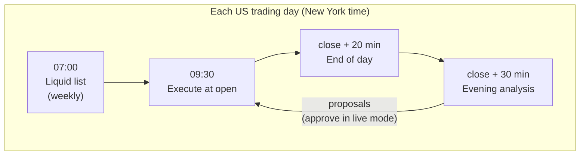
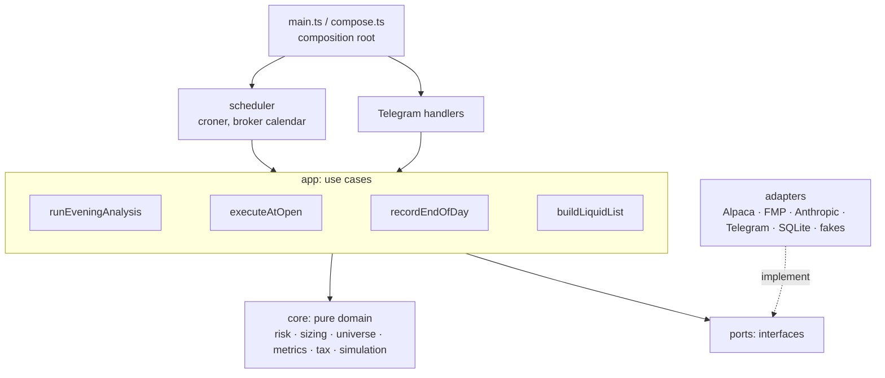

# Trading bot

[](https://github.com/achref-thamri/trading-bot/actions/workflows/ci.yml)

An AI-assisted US stock trading bot with hard risk limits in code. Once a day, after the US close, it scans the
market, asks Claude for trade decisions, checks every proposal against risk rules, and places limit orders at the
next open through Alpaca. It runs on paper money first and only goes live after beating a buy-and-hold benchmark
under criteria fixed in advance.

The LLM proposes; deterministic code decides what is allowed. Every prompt, response, risk decision and order is
stored for audit.

## Design

Domain logic lives in `core/` as pure functions, and vendor APIs sit behind interfaces in `ports/`, so a new broker,
data vendor or database is one new adapter. Risk stays outside the model: position size, position count, cash
floor, daily order caps and a daily loss halt are checked when a proposal is made and again just before it
executes, against the live account. Order ids come from proposal ids, so a retry can't submit twice. The broker is
the source of truth, margin and short selling are switched off and verified at startup, and a missed job is
alerted and never run late.

Three virtual portfolios run next to the real account on the same data: a patient Claude variant, a rule-based
momentum strategy and a buy-and-hold VT benchmark, all with estimated Danish tax.

There are 430+ tests. The domain has unit tests, the use cases run against in-memory fakes of every port, and the
adapters are tested against recorded API responses. CI runs format, lint, typecheck, tests with coverage and Docker
smoke tests, plus a production dependency audit. Dependabot opens updates weekly, commits are signed, and `main`
deploys only after CI passes.

## How it works



1. Liquid list (weekly): ~13,000 tradable assets are filtered by price and 20-day dollar volume from SIP
   bars, then by market cap and the ETF/fund flag from FMP, cached within the free plan's daily quota.
2. Evening analysis: rank the list by move × relative volume, add news mentions and holdings, cap at 40
   candidates, send portfolio, features, headlines and recent decisions to Claude. The structured answer is
   validated with zod, sized into whole shares and run through the risk checks. Proposals go to Telegram.
3. Execute at open: re-sync with the broker, re-run risk checks, place bracket limit orders (stop-loss and
   take-profit attached). Buys never chase an overnight gap.
4. End of day: snapshot equity and the benchmark, simulate the virtual portfolios, check the daily loss
   limit, send a summary.

Telegram is the only interface: approve/reject buttons, notifications, and `/status`, `/stop`, `/resume`,
`/report`, `/why TICKER`, `/golive`.

## Architecture



Dependencies point inward: `core` imports nothing outside itself, `app` talks to the world only through
`ports`, and only `adapters` know vendor APIs. See [docs/architecture.md](docs/architecture.md) for the details
and [docs/adr/](docs/adr/) for the decisions behind them.

```
src/
  main.ts, compose.ts   composition root: config → adapters → use cases → scheduler + Telegram
  config/               zod schema for env and limits; fails fast on bad config
  core/                 pure domain: risk/, universe/, strategies/, sizing, metrics, tax, simulation
  ports/                broker, marketData, news, fundamentals, llm, notifier, clock, repositories
  adapters/             alpaca/, fmp/, anthropic/, telegram/, sqlite/ (+ migrations), fake/
  app/                  one use case per file
  scheduler/            job timing, catch-up windows, missed-job alerts
  lib/                  logging, retry, errors, HTTP
```

## Tech stack

Node 24, TypeScript (strict, `noUncheckedIndexedAccess`, ESM) · zod · better-sqlite3 · croner · grammY ·
Anthropic SDK · pino · Vitest · ESLint · Prettier · husky + lint-staged · Docker · GitHub Actions.

Alpaca and FMP use small typed `fetch` clients instead of vendor SDKs.

## Getting started

Requirements: Node 24 (`.nvmrc`), and for a real run: Alpaca paper, FMP (free), Anthropic and Telegram bot keys.

```sh
npm ci
cp .env.example .env     # fill in the keys
npm run check            # format, lint, typecheck, tests
npm run dry-run -- --quick   # one evening analysis against real data, fake broker, no orders
npm run dev              # scheduler + Telegram, watching for changes
```

| Script                               | What it does                                                |
| ------------------------------------ | ----------------------------------------------------------- |
| `npm test` / `npm run test:coverage` | Run the tests (with a coverage report)                      |
| `npm run check`                      | Everything CI runs, except Docker                           |
| `npm run dry-run`                    | Full evening pipeline on live data with an in-memory broker |
| `npm run build && npm start`         | Production build and start                                  |

Risk limits, universe filters and tax rates have defaults in `src/config/schema.ts` and can be overridden with a
JSON file via `CONFIG_PATH`.

## Deployment

One container on a small VPS with Docker Compose, SQLite on a named volume, nightly online backups kept for 14
days, and a health check fed by the scheduler's heartbeat.

Merges to `main` deploy automatically once CI passes ([deploy.yml](.github/workflows/deploy.yml)). GitHub Actions
streams the tree over SSH with a key that can only run [server-deploy.sh](scripts/server-deploy.sh): it refuses to
deploy around the open and the post-close jobs, unpacks aside, removes files deleted from the repo since the last
deploy, rebuilds, and fails the deploy unless the container reports healthy within three minutes. The workflows run
with a read-only token and actions pinned to commit SHAs, which Dependabot keeps current.

Manual equivalent on the server:

```sh
docker compose up -d --build
docker compose ps        # healthy within ~2 minutes
docker compose logs -f
```

## Status

Paper trading on Alpaca. Live trading is gated on at least three months of paper results that beat the
benchmark after fees and estimated tax, with a drawdown no more than 5 points worse and no unexplained bugs in
the last 30 days.

Not financial advice. This is a personal project.

## License

[MIT](LICENSE)
