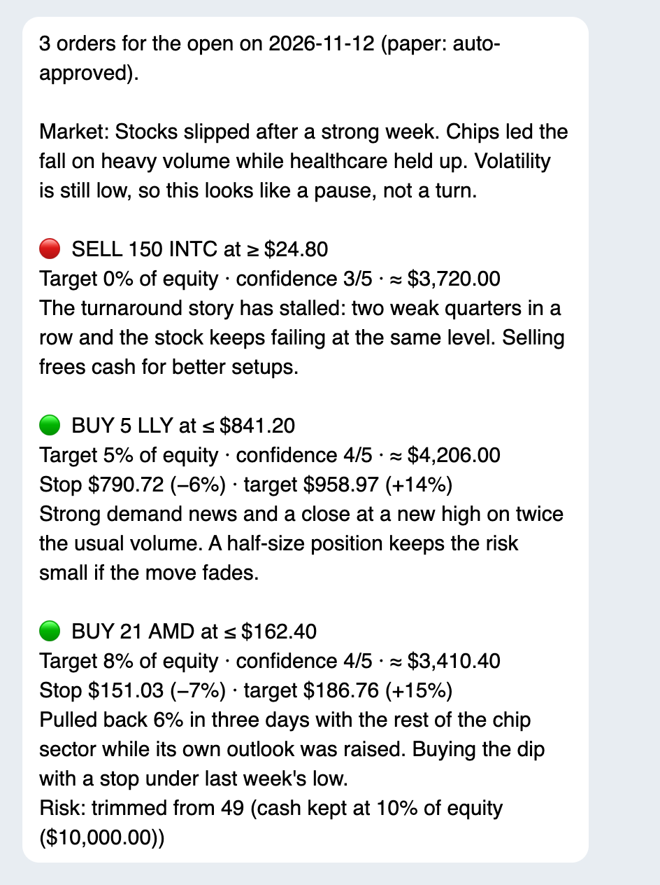
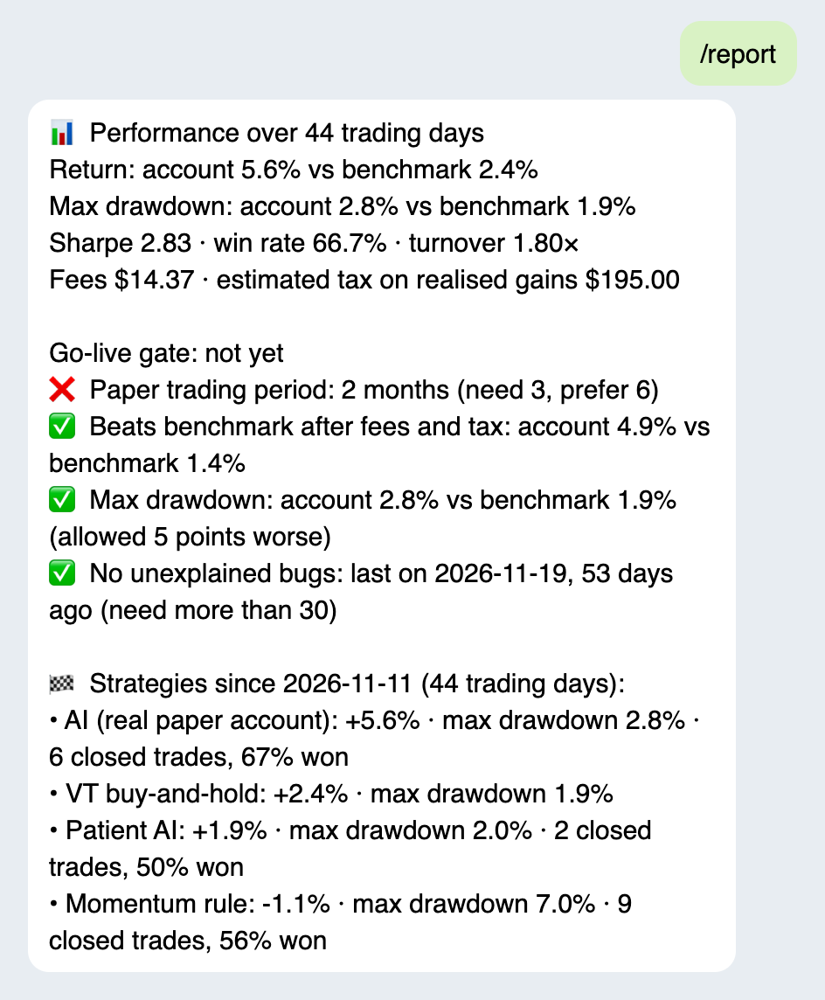
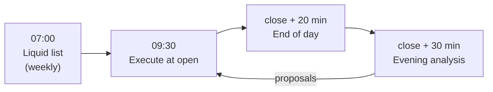

# Next Open

[](https://github.com/achref-thamri/next-open/actions/workflows/ci.yml)

Can an AI pick US stocks better than buying the whole market and holding it? Next Open tests that with a paper
account. Every evening after the close it scans the market, asks an AI model what to trade, checks every proposal
against hard risk rules in code, and places limit orders at the next open. It only goes live after beating a
buy-and-hold benchmark under rules fixed before the first trade.

<p>
  
  
</p>

_Example messages on made-up data. There are no real results yet._

## The idea

The AI proposes and deterministic code decides what is allowed. The model never places an order itself: its answer
is validated, sized into whole shares and run through the risk rules, once in the evening and again against the live
account just before the open. Every prompt, answer, risk decision and order is stored, so any trade can be explained
later with `/why TICKER`.

Results only count after fees and estimated Danish tax, and only against strategies that see the same data on the
same days:

| Strategy             | Trades                                                                        |
| -------------------- | ----------------------------------------------------------------------------- |
| AI, real account     | The model's daily decisions, placed on the Alpaca paper account               |
| Patient AI (virtual) | Same model and data, told to hold for weeks; at most 3 orders a day           |
| Momentum (virtual)   | No AI: the 10 best 3-month gainers still rising, rebalanced weekly            |
| VT buy-and-hold      | The global stock ETF bought on day one and never sold (the benchmark to beat) |

The virtual portfolios are simulated from daily bars with the same order rules as the broker.

## Risk rules

| Rule           | Limit                                                                  |
| -------------- | ---------------------------------------------------------------------- |
| Position size  | At most 20% of equity per stock                                        |
| Positions      | At most 5 at once                                                      |
| Cash           | At least 10% of equity stays in cash                                   |
| Daily activity | At most 10 orders and 40% of equity traded per day                     |
| Daily loss     | Trading halts when equity falls 3% below the previous close            |
| Entry price    | Buys at most 1% above the last close, so an overnight gap isn't chased |
| Instruments    | Long only, US common stocks, no margin, shorts, options or ETFs        |

A buy carries a stop-loss and a take-profit at the broker, both measured from the last close. The limits are defaults in
[`src/config/schema.ts`](src/config/schema.ts) and can be changed with a settings file.

## What happens each day



Times are New York time and follow the broker's calendar, so holidays and half days need no special code.

- **Liquid list**, weekly: every tradable US asset on Alpaca is cut down to listed common stocks above $5, with a
  market cap of at least $2B and $20M traded a day on average.
- **Evening analysis**: the 40 most interesting stocks of the day (holdings, news, unusual moves) go to the AI with
  the portfolio, prices and headlines. Its proposals are checked and sent to Telegram.
- **Execute at open**: the risk rules run again against the live account, then the orders go out.
- **End of day**: equity and the benchmark are recorded, the virtual portfolios are simulated, and a summary is sent.

A job that can't start on time is reported and skipped, never run late on old prices.

## On Telegram

| Command       | What it does                                                    |
| ------------- | --------------------------------------------------------------- |
| `/status`     | Account, positions, open orders and pending approvals           |
| `/report`     | Performance against the benchmark and the go-live checklist     |
| `/why TICKER` | The AI's latest reasoning for a stock                           |
| `/stop`       | Halt trading and cancel open orders (stop-losses stay in place) |
| `/resume`     | Allow trading again                                             |
| `/golive`     | Confirm live trading, once the go-live rules pass               |

The same list shows up in Telegram's command menu next to the message box, so you don't have to remember them.
Nobody else who finds the account sees it.

Telegram also gets the evening proposals, the orders placed at the open, a daily summary and a Sunday report that
compares every strategy. In live mode each order needs an Approve tap before 09:25.

## Running it

Needs Node 24. No Docker needed locally.

```sh
npm ci
npm run check                # format, lint, typecheck, unused code, tests
cp .env.example .env         # Alpaca paper, FMP (free), Anthropic and Telegram keys
npm run dry-run -- --quick   # one evening analysis on real data, fake broker, no orders
npm run dev                  # the scheduler and Telegram
```

[Running and deploying](docs/operations.md) covers the settings, going live, the dry run, deployment and backups.

## Status

Paper trading on Alpaca since 30 October 2026. Filling the stock list within FMP's free quota took the first two
weeks, so there are no trades to report yet. Going live needs at least three months of paper results that beat the
benchmark after fees and tax, a drawdown no more than 5 points worse, and no unexplained failures in the last 30
days.

## More

- [Architecture](docs/architecture.md): layers, jobs, a proposal's path, data, code layout, tech stack and tests
- [Running and deploying](docs/operations.md): settings, going live, scripts, the dry run, deployment and backups
- [Decision records](docs/adr/): why things are built the way they are

Not financial advice. This is a personal project, under the [MIT license](LICENSE).
