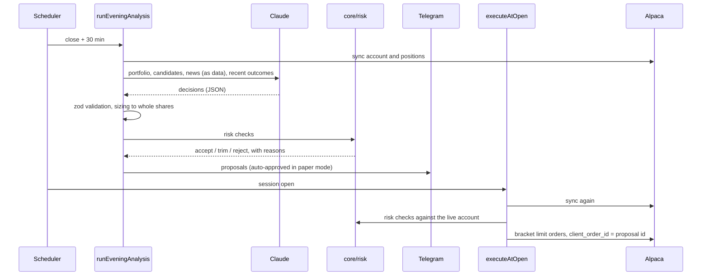

# Architecture

One long-running Node process, structured as ports and adapters so that vendors, storage and deployment shape can
change without touching the trading logic.

## Layers

| Layer       | Folder                          | Rules                                                                                                                                                                   |
| ----------- | ------------------------------- | ----------------------------------------------------------------------------------------------------------------------------------------------------------------------- |
| Core        | `src/core`                      | Pure functions and types. No I/O, no system clock, no network. Risk checks, sizing, universe filters, metrics, Danish tax, portfolio simulation, the momentum strategy. |
| Ports       | `src/ports`                     | Interfaces for everything outside the process: broker, market data, news, fundamentals, LLM, notifier, clock, repositories.                                             |
| Adapters    | `src/adapters`                  | One folder per vendor (Alpaca, FMP, Anthropic, Telegram, SQLite). The only code that knows a vendor's API. `fake/` holds in-memory versions of every port.              |
| Use cases   | `src/app`                       | One file per job or command. Orchestrate core logic through ports; receive all dependencies as one `AppDeps` object.                                                    |
| Composition | `src/compose.ts`, `src/main.ts` | Read config, build adapters, inject them, start the scheduler and Telegram.                                                                                             |

Dependencies only point inward. `core` imports nothing outside itself; `app` imports `core` and `ports`, never an
adapter. Swapping Alpaca for another broker, or SQLite for Postgres, is a new adapter and a line in `compose.ts`.

## Code layout

```
src/
  main.ts, compose.ts   composition root: config → adapters → use cases → scheduler + Telegram
  config/               zod schema for env and limits; fails fast on bad config
  core/                 pure domain: risk/, universe/, strategies/, sizing, metrics, tax, simulation
  ports/                broker, marketData, news, fundamentals, llm, notifier, clock, repositories
  adapters/             alpaca/, fmp/, anthropic/, telegram/, sqlite/ (+ migrations), fake/
  app/                  one use case per file
  scheduler/            job timing, catch-up windows, missed-job alerts
  lib/                  logging, retry, errors, HTTP
```

## Jobs and scheduling

The scheduler (`src/scheduler`) checks once a minute which jobs are due. Trading-day jobs take their times from the
broker calendar, so holidays and half days need no special code.

| Job                 | When (New York)     | Window | Does                                                                         |
| ------------------- | ------------------- | ------ | ---------------------------------------------------------------------------- |
| `backup`            | 02:00               | 6 h    | SQLite online backup, 14 days kept                                           |
| `liquid_list`       | 07:00               | 12 h   | Weekly list of liquid common stocks; continues daily while FMP profiles fill |
| `approval_reminder` | 06:00, trading days | 1 h    | Reminds about pending proposals (live mode)                                  |
| `execute_at_open`   | session open        | 15 min | Re-checks risk against the live account, places orders                       |
| `end_of_day`        | close + 20 min      | 1 h    | Equity and benchmark snapshot, virtual portfolios, daily loss check, summary |
| `evening_analysis`  | close + 30 min      | 90 min | Candidates, Claude decision, validation, sizing, risk checks, proposals      |
| `weekly_report`     | Sunday 10:00        | 12 h   | Performance against the benchmark and the go-live gate                       |

Each job runs at most once per date; the run record in SQLite survives restarts. A job that cannot start inside its
window is recorded as missed and alerted, never run late on stale prices ([ADR 0006](adr/0006-missed-jobs-are-never-replayed.md)).
Jobs run one at a time in the background so the minute tick and the health check heartbeat keep going.

## A proposal's path



Invalid model output means no trades that day and an alert, never a partial run. The full prompt, response, model id,
token usage and cost are stored per call so any decision can be replayed and explained (`/why TICKER`).

## Risk checks

`src/core/risk` has one file per rule, run in order by `runRiskChecks`. Each returns accept, trim (with a new size)
or reject, and the reason is stored and shown in Telegram.

1. Halted (manual `/stop` or daily loss stop): reject new orders.
2. Long only: no short positions.
3. Universe: the ticker must still pass the filters.
4. Max position size (10% of equity): trim.
5. Max positions (15): reject new buys unless a sell frees a slot.
6. Min cash (10%): trim buys.
7. Daily caps (10 orders, 30% of equity traded).
8. Daily loss (−3% against the previous close): halt and alert.

Limits come from config (`src/config/schema.ts`), validated at startup.

## Data

SQLite (better-sqlite3) with versioned migrations (`PRAGMA user_version`, `src/adapters/sqlite/migrations`).

| Area                | Tables                                                                   |
| ------------------- | ------------------------------------------------------------------------ |
| Audit trail         | `runs`, `candidates`, `llm_calls`, `decisions`, `proposals`              |
| Trading             | `orders`, `fills`, `equity_snapshots`, `settings`                        |
| Universe cache      | `profiles`, `liquid_lists`, `api_usage`                                  |
| Strategy comparison | `shadow_portfolios`, `shadow_orders`, `shadow_fills`, `shadow_snapshots` |

The broker is the source of truth for positions and cash; the database records what Next Open intended and why.

## Strategy comparison

Next to the real (paper) account, three virtual portfolios start with the same capital and see the same data each
evening: `claude_patient` (a second prompt that favours few trades and long holds), `momentum` (a weekly rule-based
rebalance, no AI) and a VT buy-and-hold benchmark. `core/simulation.ts` fills their orders from the next day's bars
(limit vs open, stop before target on the same day, gaps). Daily and weekly reports compare all of them, after fees
and estimated Danish tax, so the paper period answers whether the AI adds anything over a simple rule.

## Failure handling

- External calls retry transient errors with backoff (`lib/retry.ts`); persistent failure fails the job and alerts.
- Daily vendor quotas are budgeted per day in SQLite (`api_usage`); hitting one pauses the job until the next day
  instead of failing it.
- Orders use `client_order_id` derived from the proposal id, so retries and restarts cannot double-submit.
- At startup Next Open switches margin and short selling off at the broker and refuses to run if it cannot verify it.
- Going live needs both `TRADING_MODE=live` and a `/golive` confirmation in Telegram.

## Testing

| Level       | What                                                 | How                                                     |
| ----------- | ---------------------------------------------------- | ------------------------------------------------------- |
| Domain      | Risk, sizing, filters, metrics, tax, simulation      | Plain unit tests                                        |
| Use cases   | Full daily pipeline, idempotency, halts, missed jobs | In-memory fakes of every port, with injectable failures |
| Adapters    | Alpaca, FMP, Anthropic mapping and error handling    | Recorded API responses in `__fixtures__`                |
| Persistence | Repositories and migrations                          | In-memory SQLite                                        |
| Container   | Native module loads, config fails fast, health check | CI Docker job                                           |

Tests live in `__tests__` folders next to the code. `npm run check` runs everything CI runs except Docker.

## Tech stack

Node 24 and TypeScript (strict, `noUncheckedIndexedAccess`, ESM), zod, better-sqlite3, croner, grammY, the
Anthropic SDK and pino. Alpaca and FMP use small typed `fetch` clients instead of vendor SDKs
([ADR 0007](adr/0007-sqlite-and-typed-fetch-clients.md)). Tooling is Vitest, ESLint, Prettier, knip, husky with
lint-staged, Docker and GitHub Actions.

## Quality checks

CI runs format, lint, typecheck, knip (unused code), the tests with coverage thresholds, Docker smoke tests (the
native SQLite module loads, bad config fails fast, the health check fails without a heartbeat) and an audit of the
production dependencies. Dependabot opens updates every Saturday. Commits have been signed since 31 October 2026,
and `main` deploys only after CI passes.
